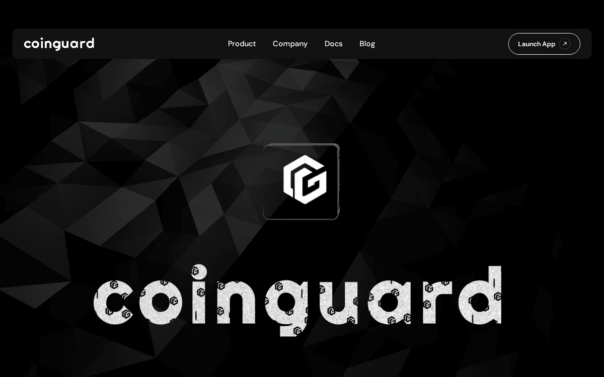
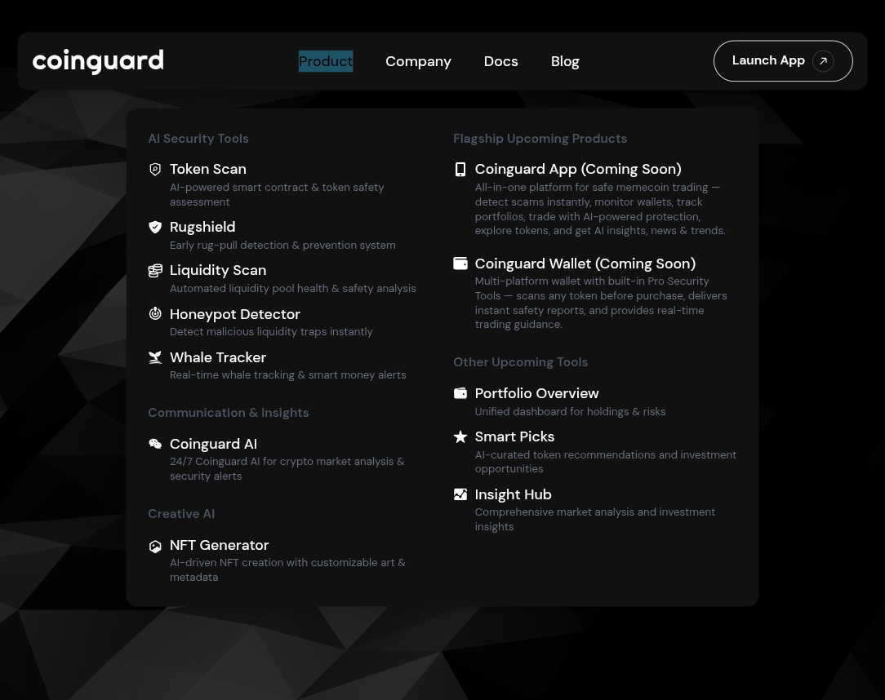

# CoinGuard: AI-Powered Web3 Security Platform

**Live:** https://www.coinguard.ai/

Freelance project delivered in 2 months. Part of a team; I developed 70%+ of the platform. The source code is private (team project).

CoinGuard helps users check tokens before they invest. It scans Ethereum, BSC and Solana tokens for rug pulls, honeypots, dev backdoors, bots, presale scams, wash trading, low liquidity and pump-and-dump risks.

## What I built
- Landing page and public site (React + Vite): 3D animated cube hero, product navigation, Whitepaper, About and Legal pages
- Token Scan API (Node.js): supply, holders, price, liquidity, 24h volume, top-10 holder distribution and a 0-100 risk score (Low / Moderate / High)
- Token Scan web app with chain selector and app sidebar
- Security tools: RugShield, Liquidity Scanner, Honeypot Detector, Whale Tracker
- Coinguard AI chat (Next.js, Node.js/Express, TypeScript): live prices from CoinGecko and DexScreener, chart-image analysis, tool recommendations, rate limiting
- NFT Generator with customizable art and metadata

## Tech stack
React, Vite, Lottie, Next.js, TypeScript, TailwindCSS, Node.js, Express, Moralis, Helius, Subsquid, Ponder, OpenRouter

## Screenshots

[Watch demo video](screen-20261121-140118~2.mp4)
